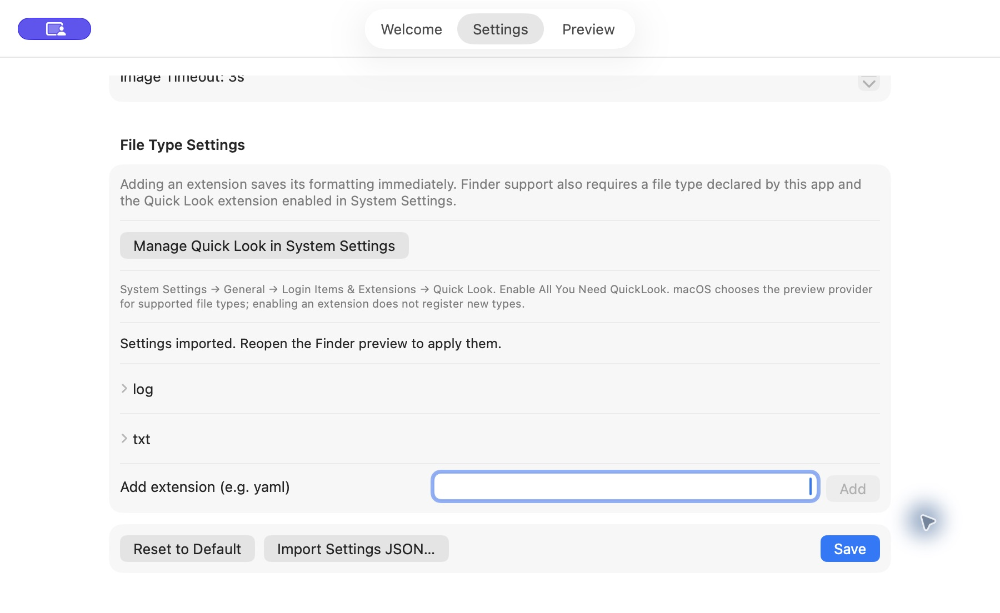
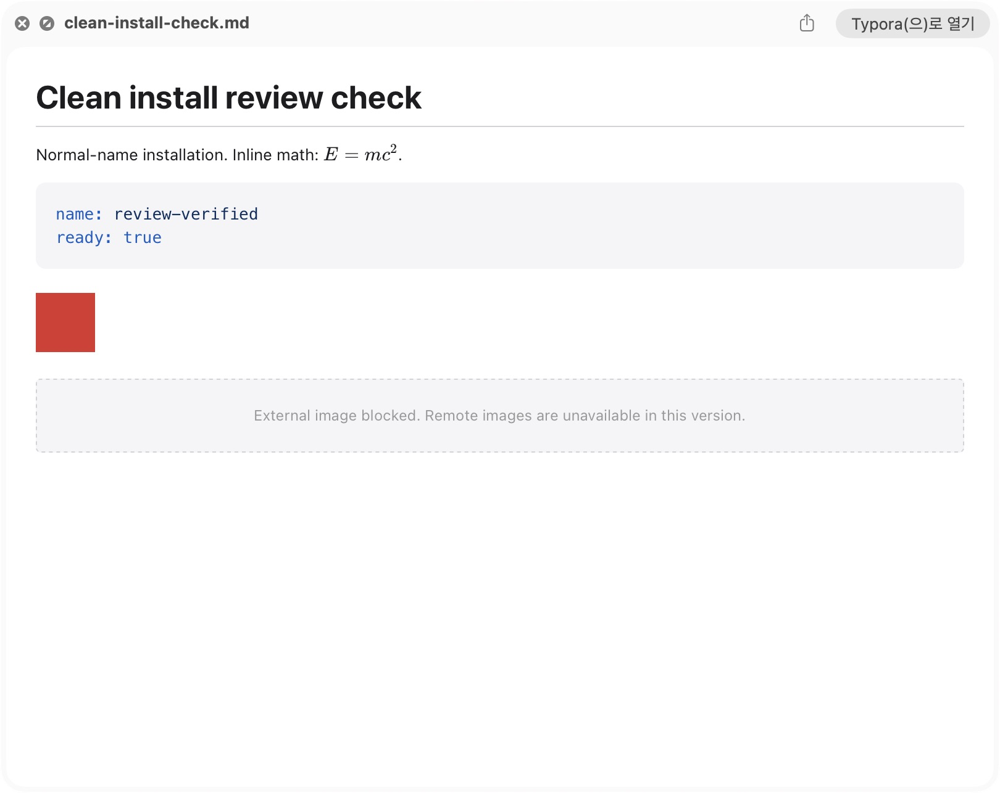

# PR #14 리뷰 수정 및 정식 이름 설치 검증

검증일: 2026-10-26 KST. 현재 상태 기준 문서는 [PROJECT_STATUS.md](../../PROJECT_STATUS.md).
대상: DevFolder의 `all-you-need-quicklook`, 브랜치 `feat/quicklook-runtime-file-type-settings`.
최초 PR 커밋 `eae3fa6c1655e7c4bbd7949aea1df3528baf578f`의 리뷰를 검토했다.
PR: https://github.com/OE-Park/all-you-need-quicklook/pull/14 (미머지).

## 리뷰 판정

Copilot 코멘트 7건은 COMMENTED 리뷰다. 아래는 구현·근거에 대한 판정이며,
GitHub 스레드를 해결 처리하거나 외부 리뷰어의 승인을 대신한 것은 아니다.

| 코멘트 ID | 문제 | 판정과 반영 |
| --- | --- | --- |
| 4375957893 | WebKit 직접 로딩에서 응답 25 MiB 제한 소실 | 유효. 제한 없는 원격 전송을 제거하고 HTTP(S)를 CSP에서 차단. 전송 구현을 고쳤다고 주장하지 않고 기능을 비활성화 |
| 4375957965 | Add가 다른 미저장 설정도 저장 | 유효. 디스크 설정에 확장자만 추가하고 UI의 다른 변경은 초안으로 유지 |
| 4375958018 | 과거 App Group 설정 이전 경로 없음 | 명시적 JSON 가져오기 추가. 선택 파일을 검증한 뒤 저장. 이번 초기화 요청에 맞춰 자동 복구는 수행하지 않음 |
| 4375958052 | 접근 거부를 파일 부재로 오인 | 유효. 먼저 읽고 실제 no-such-file 오류만 정상 기본값 처리. 접근·디코딩 실패는 unreadable 경고 유지 |
| 4375958085 | srcset/picture 원격 후보가 제한 우회 | 유효. img src/srcset, picture source 후보를 검사해 원격 이미지 대체 표시. CSP에서도 차단 |
| 4375958119 | lazy 이미지가 요청 전 시간초과 | 원격 전송 비활성화로 해당 경로 제거. 남은 로컬·임베디드 이미지는 eager 처리 |
| 4375958165 | Plotly sidecar 라이선스 누락 주장 | 공식 npm 2.35.2에도 해당 sidecar 없음. 공식 MIT 원문으로 교체하고 파일 목록·해시·출처를 PROVENANCE.json에 기록 |

외부 이미지 스위치와 timeout UI는 비활성화했다. legacy JSON의
`allowExternalImages=true`도 HTTP(S)를 허용하지 않는다. 원격 이미지는 기능 미지원 상태이며
25 MiB 제한 다운로드 성공으로 해석하면 안 된다. 로컬·data 이미지 지원은 유지한다.
공식 Plotly 배포 대조는 해당 파일·MIT 고지 검증 범위이며 의존성 라이선스 전수 감사는 아니다.

## 실행 검증

- 의미 재현: 선택한 42개 테스트에서 수정 전 5개 실패 (`build/pr-review-reproduction.log`).
- 전체 XCTest: **279개, 실패 0개**, TEST SUCCEEDED (`build/pr-review-green.log`).
- 실행 명령: `xcodebuild test -project AllYouNeedQuickLook.xcodeproj -scheme Tests -destination platform=macOS -derivedDataPath build/runtime-tests`.
- 범위: Add의 저장·초안 분리, 정상/손상 import, 접근 불가 파일 경고, legacy opt-in CSP 차단, responsive/lazy 원격 후보의 loopback 요청 0건, 기존 렌더러 회귀.
- Release: BUILD SUCCEEDED (`build/clean-install/release-build.log`). `-configuration Release -derivedDataPath build/clean-install/ReleaseData build`.
- 설치 앱: `codesign --verify --deep --strict` 통과. 설치한 Plotly 라이선스와 저장소 원문 일치.
- 읽기 전용 후속 코드 검토: P1/P2 추가 지적 없음. 이는 외부 PR 재승인을 뜻하지 않음.

## 기존 사본 정리와 설정 리셋

사용자의 삭제 요청은 이 프로젝트의 앱·디버그 사본에 적용했다. 다른 앱은 삭제하지 않았다.
삭제 전에 bundle ID, 경로, suffix를 확인하고 프로젝트 네임스페이스로 범위를 제한했다.

- 기존 `.app` 4개 제거: `/Applications`의 이전 사본, validation Debug 사본, `dd38b75d`와 `2f543413` 랜덤 사본.
- 남아 있던 독립 테스트 `.appex` 사본 및 설치용 임시 Release `.app`/`.appex` 제거.
- Application Support, Containers, legacy Group Containers, Preferences, Caches, WebKit의 기존 설정 경로 16개 정리.
- 기존 테스트 설정 백업 임시 JSON 제거, Quick Look 캐시 초기화, 기존 프로젝트 확장 등록 정리.
- 호스트 bundle ID의 `tccutil reset All` 성공. 확장 ID의 별도 reset은 OSStatus -10814로 실패하므로 확장별 TCC 리셋 성공으로 보고하지 않음.
- macOS 보호 `.com.apple.containermanagerd.metadata.plist`와 컨테이너 껍데기 9개는 Operation not permitted로 잔존. 정리 직후 이 경로들에서 실제 데이터 파일 0개 확인. 보호를 우회하지 않음.
- 새 앱 실행으로 기본 설정·런타임 데이터는 다시 생성됨. GUI 테스트 후 저장 JSON과 번들 기본값이 같음을 확인.

초기/최종 조사: `/Applications`, `~/Applications`, `~/Projects`, Xcode DerivedData,
`/private/tmp`, 시스템 temp, Downloads, Desktop, Codex worktrees, `/Users/Shared`, Spotlight와 pluginkit.
최종 `final-inventory.json`에서 프로젝트 앱은 아래 정식 사본 1개, 등록 확장은 그 안의 활성 확장 1개다.
조사 중 접근 불가 경로 58개가 있으므로 접근 불가 영역까지 사본 부재를 증명하지 않는다.

로컬 감사 자료 (Git 제외): `build/clean-install/inventory.json`, `cleanup-result.json`,
`additional-removed.json`, `final-inventory.json`, `install_clean.py`.

## 설치 후 실제 앱·Finder 확인

설치 위치: **`/Applications/AllYouNeedQuickLook.app`** (랜덤 접미사 없음).
호스트 ID: `com.yohanpark.AllYouNeedQuickLook`.
활성 확장: `com.yohanpark.AllYouNeedQuickLook.QuickLookExtension`.

컴퓨터 도구로 아래를 확인했다.

1. 기본 fontSize 13에서 UI 초안만 14로 변경한 뒤 yaml Add. 디스크 fontSize는 13, 파일 타입에 yaml만 추가, UI 초안은 14 유지.
2. 파일 선택창으로 `settings-import.json` 가져오기. UI와 디스크 fontSize 17, 가져오기 성공 안내 확인.
3. Reset to Default 실행. 디스크 JSON이 `Shared/Resources/default-config.json`과 동일함을 assertion으로 확인 (fontSize 13, log/txt, 원격 이미지 off).
4. 새 Markdown을 Finder Space로 열고 수식, YAML 구문 강조, 빨간 로컬 이미지, 외부 이미지 차단 안내를 시각 확인.
5. Finder AX의 HTML content 경로가 `file:///Applications/AllYouNeedQuickLook.app/Contents/Frameworks/Shared.framework/Resources/`임을 확인. 다른 테스트 사본의 화면으로 오인하지 않음.

샘플: `/Users/yohanpark/Projects/TEST_SAMPLES/all-you-need-quicklook/review-clean-install/`.

## 남은 범위

- 후속 PR CI와 외부 재리뷰 결과 확인. 기존 리뷰 스레드는 자동 해결 처리하지 않음.
- 원격 이미지의 제한 가능한 전송 설계·구현·Finder 검증 후 기능 재활성화 검토.
- 81개 corpus의 양쪽 화면 모드 전수검사, Plotly 최초 Finder 시간 측정.
- Developer ID 정식 서명, notarization, 배포 패키지 검증. 현재 설치는 로컬 ad-hoc 빌드.
