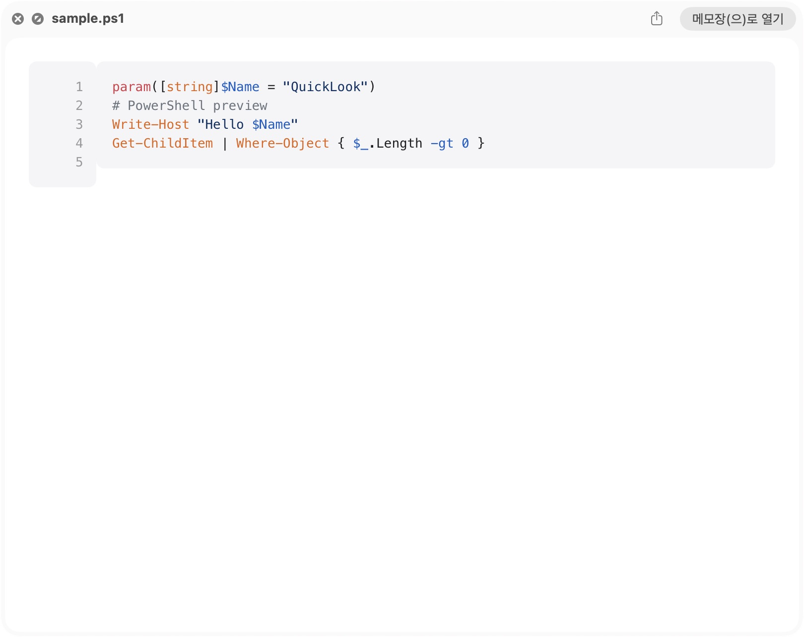
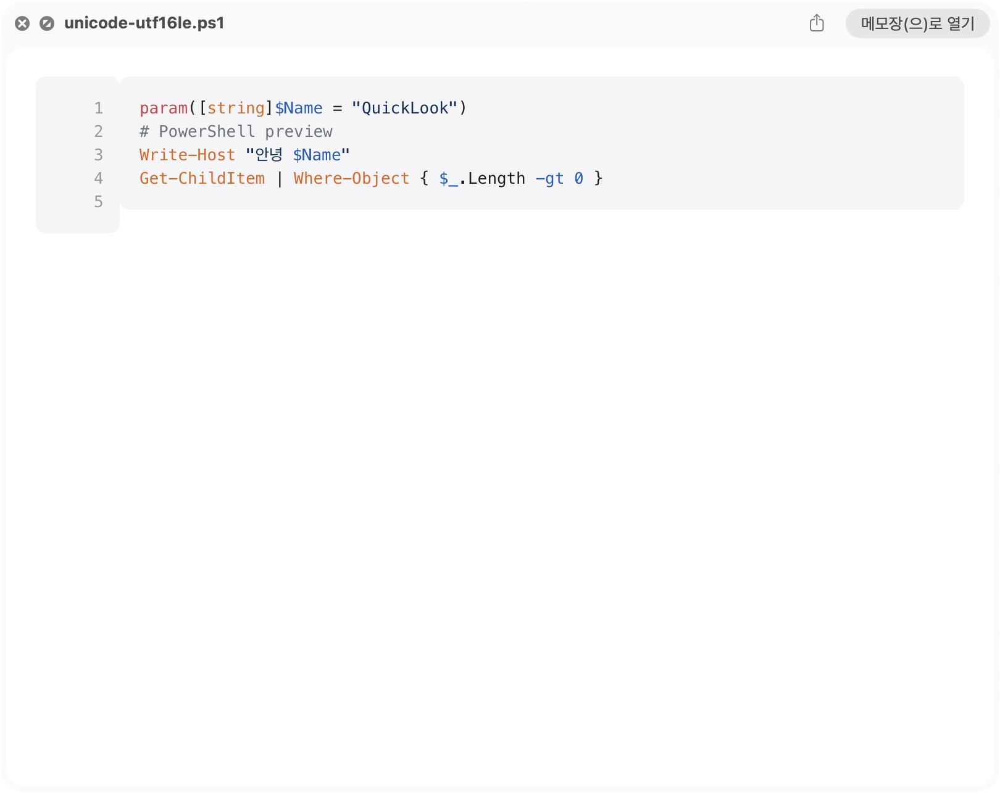
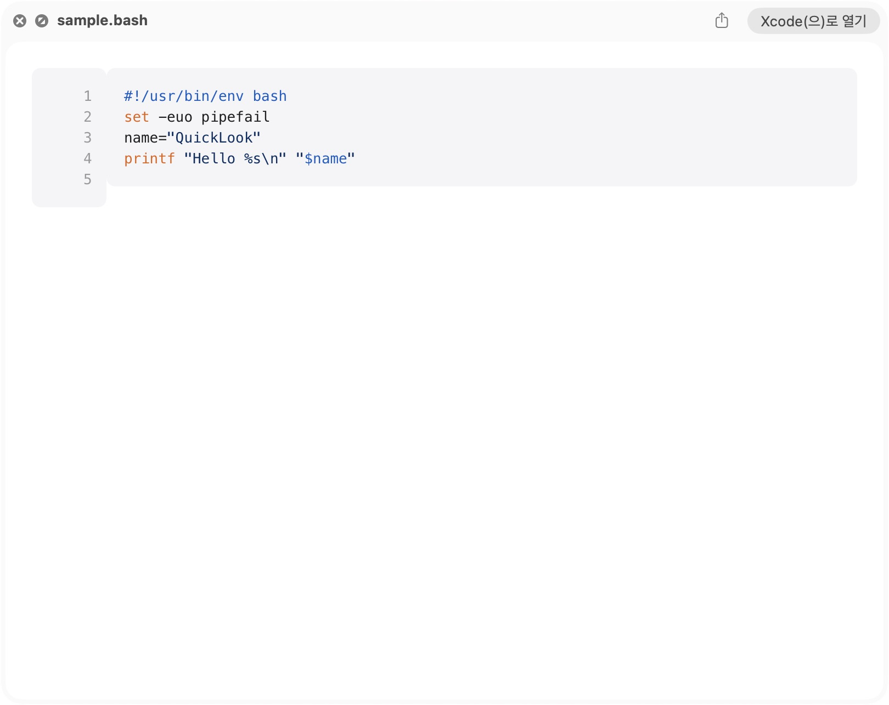
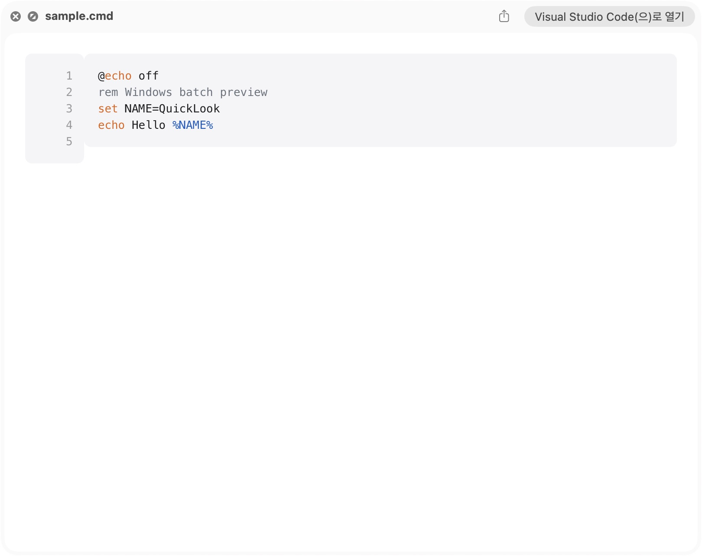
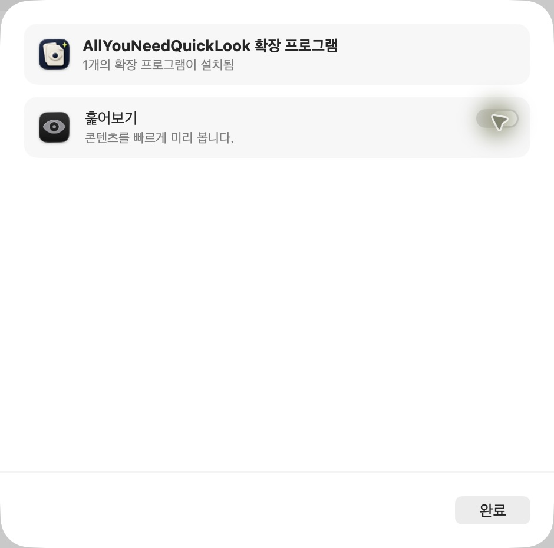

# 소스코드·스크립트 확장자 및 네이티브 활성화 검증

2026-10-27 KST. 상태 기준: [PROJECT_STATUS.md](../../PROJECT_STATUS.md).
작업 경로: `/Users/yohanpark/Projects/DevFolder/Workspace/yohanpark-dev/public_repos/all-you-need-quicklook`.
브랜치 `feat/quicklook-runtime-file-type-settings`, 작업 시작 HEAD `ac6caed`.

## 반영 범위

- 소스 타입 61개 그룹에 확장자 252개 선언. 강조 매핑은 기존 Markdown·TypeScript ts 포함 255개 키. 이 숫자는 각 확장자의 Finder 전수 성공 횟수가 아니다.
- 기존 시스템·편집기 소스 타입 48개도 QLSupportedContentTypes에 구체적으로 선언. 상위 public.source-code만 선언했을 때 Bash가 기본 미리보기로 가는 실제 재현에 대응.
- 호스트와 appex가 같은 타입 선언을 사용하도록 project.yml YAML anchor 적용.
- highlight.js 11.12.0 공식 문법 30개 추가. BSD 원문·다운로드 출처·해시 보존. 번들 JS는 기존 nonce/CSP 경로로만 인라인 실행.
- 미지원 문법은 명시적 plaintext. 소스/스크립트는 실행하지 않는다.
- UTF-8/16/32 BOM과 양 endian 처리. PowerShell UTF-16LE 한글 정상 표시. 잘린 Unicode 단위를 Latin-1로 조용히 오인하지 않도록 검사.
- 앱 설정은 File Formatting으로 명확히 구분. 활성화 토글을 만들지 않고 시스템 설정 이동 버튼과 안내만 유지. 기존 사용자 서식 JSON은 리셋하지 않음.

전체 확장자 목록과 제약: [SOURCE_FORMATS.md](../SOURCE_FORMATS.md).
.ts는 MPEG transport stream과 겹쳐 새 타입 등록에서 제외. .wasm은 바이너리라 텍스트 선언에서 제외.
이 Mac에서 .exs는 Logic 타입으로 계속 해석되는 것을 관찰했으므로 해당 확장자의 제공자 선택 성공을 주장하지 않는다.
확장자 없는 Dockerfile·Makefile 및 dotfile 이름 감지는 별도 범위다.

## 테스트·빌드

- 언어 추가 전 테스트 실패로 PowerShell 등 누락 재현 (`build/source-expansion/red.log`).
- 새 Unicode 테스트의 미구현 실패와 홀수 UTF-16 입력 묵인 재현 후 수정.
- 최종 XCTest 285개, 실패 0개, TEST SUCCEEDED (`build/source-expansion/tests-grammars.log`).
- 기존 라이브 WKWebView 테스트에 매핑 언어 각각의 hljs.getLanguage 등록 확인 추가. PowerShell·배치·CMake 토큰 생성 assertions 통과.
- 최종 Release BUILD SUCCEEDED (`build/source-expansion/build-concrete.log`).
- 설치본 deep/strict 서명 검증 및 `Identifier=com.yohanpark.AllYouNeedQuickLook`, `Info.plist entries=23` 확인.
- 코드 후속 검토에서 UTF-16 문제를 찾아 수정했으며 재검토에서 새 P1/P2 지적 없음. 외부 PR 승인을 대신하지 않는다.

## 설치와 실제 Finder

설치본은 `/Applications/AllYouNeedQuickLook.app`. 빌드용 앱과 standalone appex는 정리했고,
최종 pluginkit 조회에서 이 경로의 활성 확장 1개 확인. 앱 교체 시 기존 설정과 네이티브 활성화 선택 유지.

컴퓨터 도구로 생성 corpus의 아래 파일을 Finder Space에서 확인했다.
각 앱 성공 판정은 AX HTML resource 경로가 `/Applications/AllYouNeedQuickLook.app/Contents/Frameworks/Shared.framework/Resources/`인 것을 함께 확인했다.

| 파일 | 실제 결과 |
| --- | --- |
| sample.ps1 | 앱 렌더러의 PowerShell 강조 |
| unicode-utf16le.ps1 | 한글 안녕 보존, PowerShell 강조, NUL 없음 |
| sample.cmd | 앱 렌더러의 Windows 배치 강조 |
| sample.bash | 시스템 타입을 구체 선언한 최종 빌드에서 앱 Bash 강조 |
| sample.sh | 앱 shell 강조 |
| sample.cmake | 앱 CMake 강조 |
| sample.tf | 앱의 읽을 수 있는 일반 텍스트 대체 표시 |

처음 확인한 기본 텍스트 제공자 화면은 앱 렌더링 성공으로 계산하지 않았다.
시스템 설정에서 실제 토글 off/on 전환 확인 후 on 복원. 앱은 활성화 명령을 실행하지 않는다.

Corpus: `/Users/yohanpark/Projects/TEST_SAMPLES/all-you-need-quicklook/2026-10-27-expanded`.
생성기 `scripts/make-preview-corpus.py`가 새 suffix별 샘플과 UTF-16 fixture를 생성한다.
새 corpus 335개 파일. 새 확장자 각각의 양쪽 화면 모드 전수 시각 검증은 미실행.
이번 Finder 확인은 Light 대표 사례이며, 전체 시각 검증 완료로 표시하지 않는다.

## 서명 순서 문제와 해결 근거

새 host Info.plist 도입 후 post-build 서명이 plist 처리보다 먼저 실행되는 순서가 드러났다.
이때 codesign verify는 통과하지만 `Info.plist=not bound`, 실행 시 libsystem_secinit에서
bundle identifier를 얻지 못해 종료됐다. 빌드 script inputFiles에 처리된 Info.plist를
의존성으로 선언하고 서명 스크립트에도 파일/ID guard를 추가했다.
수정 후 로그에서 ProcessInfoPlistFile → signing 순서, 올바른 signature identifier,
호스트 실제 실행과 Finder 확장 실행을 확인했다. 단순 서명 verify만으로 정상 실행을 판단하지 않는다.

## 남은 범위

- 252개 suffix의 실제 Finder 제공자 선택 전수검사와 양쪽 화면 모드 시각 검증.
- 충돌 형식의 다른 앱 설치 환경별 확인. macOS의 제공자 선택을 강제로 바꾸지 않음.
- 외부 이미지 bounded transport, 정식 서명·notarization과 배포 검증은 이전 보고서의 미완료 상태 유지.
